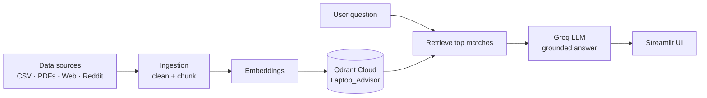

# Laptop Advisor

An AI-powered laptop recommendation app for the **Indian market**. Tell it what you need ("a laptop under ₹70,000 for coding and light video editing") and it compares options from its knowledge base and recommends laptops that fit your requirements, with reasons.

Built with Retrieval-Augmented Generation (RAG): the answer is grounded in real data instead of the model's memory.

## Features

**Available now**
- Natural-language laptop questions, answered from structured laptop data (India market)
- Vector search over laptop specs and prices stored in Qdrant Cloud
- Fast LLM responses via Groq
- Simple Streamlit web UI, deployed online

**Planned**
- More input types in one RAG ("multi-input RAG"): large PDF files (spec sheets, reviews), web pages and APIs
- Real-user opinions from Reddit and similar communities
- Prompt caching to cut cost and latency
- Side-by-side comparison across sources
- Evaluation of answer quality and hallucination

## How it works



1. Laptop data is cleaned, embedded and stored in a Qdrant collection.
2. A user question is embedded and the most relevant laptops or passages are retrieved.
3. The retrieved context and the question go to the LLM, which recommends laptops based only on that context.

## Tech stack

| Part | Tool |
|---|---|
| UI | Streamlit |
| LLM | Groq |
| Vector database | Qdrant Cloud (free tier) |
| Data | CSV today; PDFs, web pages, Reddit planned |
| Language | Python |

## Project structure

```
laptop-advisor/
├── data/
│   ├── structured/     # laptops_india.csv and other tabular data
│   ├── pdfs/           # PDF documents (planned)
│   └── web/            # scraped web pages (planned)
├── app.py              # Streamlit app
├── requirements.txt
├── .env                # your keys (never commit this)
└── README.md
```

> Adjust file names above to match your repository.

## Getting started

### 1. Clone and install

```bash
git clone <your-repo-url>
cd laptop-advisor
python -m venv venv
source venv/bin/activate        # Windows: venv\Scripts\activate
pip install -r requirements.txt
```

### 2. Configure environment variables

Create a `.env` file in the project root:

```env
GROQ_API_KEY=your_groq_key
QDRANT_URL=https://your-cluster-url
QDRANT_API_KEY=your_qdrant_key
```

### 3. Load the data

Put `laptops_india.csv` in `data/structured/`, then run your ingestion script to embed it and upload it to the `Laptop_Advisor` collection in Qdrant.

### 4. Run the app

```bash
streamlit run app.py
```

## Example questions

- "Best laptop under ₹60,000 for programming?"
- "Compare lightweight laptops with good battery life for travel."
- "I need a laptop for video editing with a dedicated GPU, budget ₹90,000."

## Roadmap

- [x] CSV data + Qdrant Cloud + Groq + Streamlit, deployed
- [ ] Add PDF ingestion (including large PDFs)
- [ ] Add web page ingestion
- [ ] Add Reddit reviews (Reddit API access requested)
- [ ] Prompt caching
- [ ] Evaluation and hallucination checks

## Limitations

- Prices and availability change often; the data reflects when it was collected.
- Recommendations are only as good as the data in the knowledge base.
- Always verify the final price and specs on the seller's website before buying.

## License

Add your license here (for example MIT).